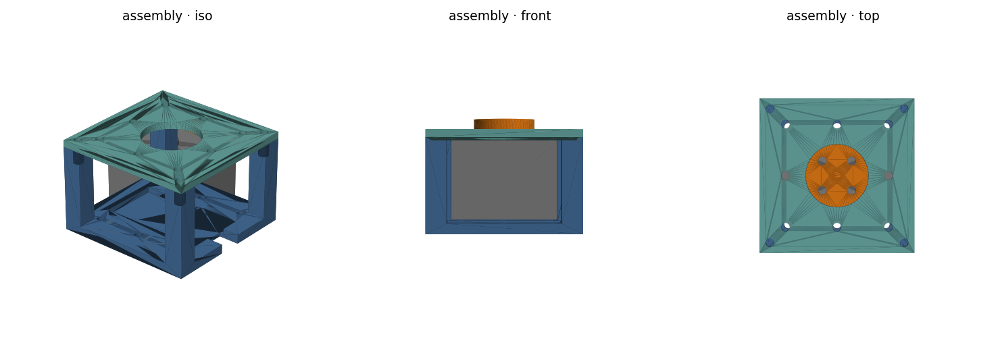
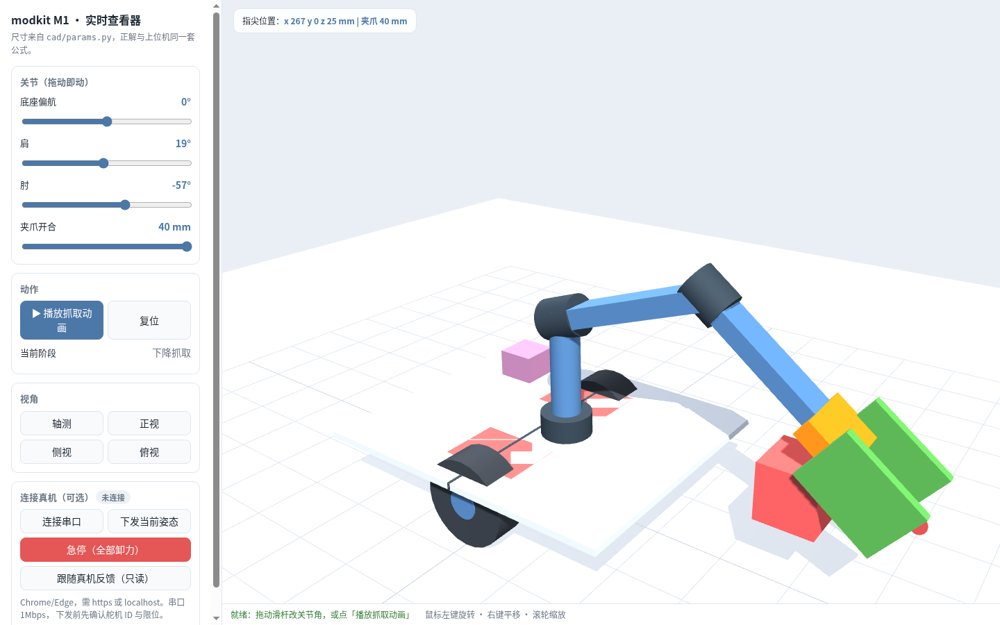
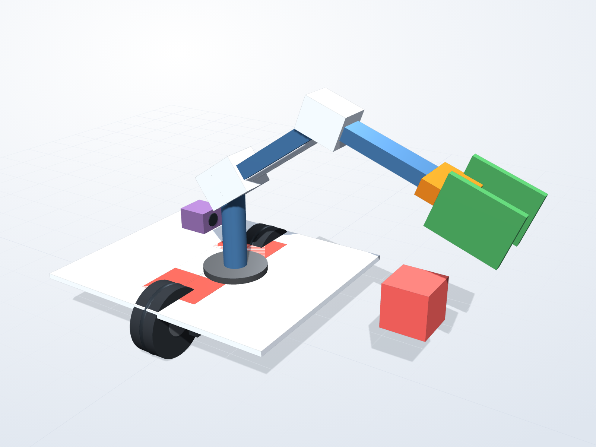

# modkit M1 · 可拆装模块化机器人

[](https://github.com/gh503/robot-modkit/actions/workflows/ci.yml)
[](LICENSE)
[](https://github.com/gh503/robot-modkit/releases)
[](https://gh503.github.io/robot-modkit/)

> 一台"接口先定、形态后长"的机器人：**差速底盘 + 4 自由度臂 + 夹爪**，
> 目标不是演示视频，而是**能独立完成物理任务**（导航到指定位置 → 识别目标 → 抓取 → 放到另一处）。
>
> 面向新手：从零基础到能自己改图纸、改固件、加传感器，手册在 [docs/07-小白操作手册.md](docs/07-小白操作手册.md)。



**在线看：<https://gh503.github.io/robot-modkit/>** —— 浏览器里拖动滑杆改关节角、播放抓取动画、
也可以直接连总线舵机（Chrome/Edge 的 Web Serial）。

[](https://gh503.github.io/robot-modkit/)



## 它现在到了哪一步

| 层 | 状态 | 证据 |
|---|---|---|
| 机械：关节模块（M0） | ✅ 可用 | 5 个零件、33 项几何自检（干涉/间隙/壁厚/水密） |
| 机械：底盘 + 夹爪 + 相机架（M1） | ✅ 出图 | 新增 7 个零件，几何自检 **79 项全 PASS**（含校准件） |
| 固件：总线协议 + 驱动 + 底盘闭环 | ✅ 可用 | **71 项** C++ 测试（协议 41 + 底盘 30） |
| 固件：ESP32 平台层 | 🟡 编译通过 | esp32s3 交叉编译 OK；⚠️ 未上真实硬件 |
| 上位机：协议/运动学/仿真/CLI | ✅ 可用 | 26 项 pytest（含 2000 样本随机 IK）；无硬件可跑全流程 |
| 仿真：整机多视图 + 抓取动画 + 底盘闭环 | ✅ 可用 | 5 张图 + 121 帧 GIF；闭环判据 7mm / 0.1° 全过 |
| 打印校准件 + 三张拼盘 | ✅ 可用 | `print_gauge`、`plate_A/B/C.stl`，85 项自检 |
| 自主任务（导航+视觉+抓取） | ⬜ 未开始 | 路线图 M3–M5 |
| 整机实测 | ⬜ 未开始 | 等你的打印机和舵机 |

> 这张表是**唯一可信的状态声明**。任何"应该能行"都不写进来。

## 可视化 / 仿真

| 想做什么 | 怎么做 |
|---|---|
| 网页里实时转、实时摆姿态 | 打开 <https://gh503.github.io/robot-modkit/>（或本地 `cd web && python3 -m http.server`） |
| 生成高质量四视图 / 爆炸图 | `make -C sim shots`（需本机有 Chrome） |
| 抓取动画 GIF | `make -C sim grasp` 或 `make -C sim shots` |
| 底盘闭环仿真 | `make -C sim drive` |
| 打印前先验证打印机精度 | 打 `cad/out/print_gauge.stl`（`build.py` 顺带导出），流程见 [docs/13](docs/13-业界实践对照.md) |
| 拼打印板 | `cd cad && python plate.py` → `plate_A/B/C.stl` |

## 三分钟上手（不需要任何硬件）

```bash
git clone https://github.com/gh503/robot-modkit.git && cd robot-modkit
python3 -m venv .venv && ./.venv/bin/pip install -e software
./.venv/bin/python -m modkit.cli --sim scan          # 扫描仿真舵机
./.venv/bin/python -m modkit.cli --sim pose --x 150 --y 0 --z 150   # 逆解到点
./.venv/bin/python -m modkit.cli --sim demo          # 逐关节摆动
```

看整机长什么样、动作顺不顺（不需要硬件）：

```bash
make -C sim views    # 四视图 + 尺寸图 + 工作空间
make -C sim grasp    # 抓取动画 GIF
make -C sim drive    # 底盘闭环仿真（打印判据）
```

看图纸、跑自检：

```bash
cd cad && ../.venv/bin/python build.py     # 生成 STEP/STL + 33 项几何断言
../.venv/bin/python render.py              # 出三视图预览
```

跑测试（ROS 环境下的 pytest 插件会互相打架，见下方"已知坑"）：

```bash
cd software && PYTEST_DISABLE_PLUGIN_AUTOLOAD=1 ../.venv/bin/python -m pytest
cd firmware && make test
```

## 目录

```
docs/     00 计划 · 01 系统设计 · 02 接口 · 03 配电 · 04 BOM · 11 零件清单 · 12 仿真
          05 装配 · 06 调试测试 · 07 小白手册 · 08 学习路径 · 09 故障排查 · 10 决策
cad/      params.py（唯一尺寸源）· parts.py（M0）· parts_m1.py（整机）· build.py · render.py
sim/      model.py（可动模型）· draw.py（多视图）· anim_grasp.py（动画）· drive.py（闭环仿真）
firmware/ src/（协议+驱动，可脱离硬件测试）· esp32/（平台层）· test/（假总线）
software/ modkit/（协议/运动学/仿真/CLI）· tests/
```

## 设计主张（为什么长这样）

1. **接口先于形态**：全机一个 20mm M3 网格、一种螺钉、一条三线总线。换构型改的是"用哪几块板"。
2. **免测量优先**：舵机靠浅槽+压盖固定，不依赖官方未公布的安装孔坐标。
3. **间隙是设计值**：旋转件与固定件 0.6mm、舵机与盖板 0.4mm，由脚本断言而非试装。
4. **每层可独立验证**：CAD 有几何断言、协议有字节断言、运动学有数值断言、平台层可仿真。硬件坏了，软件照样能测。

## 已知坑（踩过，记下来）

- ROS 2 Humble 的 `launch_testing` 会被 pytest 自动加载并因缺 `pyyaml` 报错 → 用 `PYTEST_DISABLE_PLUGIN_AUTOLOAD=1`。
- 本机 `~/Documents/infra-dev` 是另一个项目（Jarvis），故本项目独立在 `~/Documents/robot-modkit`，独立 git 仓库。
- 机械臂逆解的肩角符号写反过一次，被 `test_forward_ik_roundtrip` 抓住 —— 所以那条测试必须保留。

## 参与

- 想改东西：先看 [CONTRIBUTING.md](CONTRIBUTING.md)（五条必跑命令 + 六条硬规则）
- 想提问题：用 [issue 模板](.github/ISSUE_TEMPLATE/)
- **要有尺寸的图纸**：[13 页工程图](docs/drawings/modkit-m1-drawings.pdf)（A4 可直接打印）
- **要真的造出来**：[docs/15-生产链路总览](docs/15-生产链路总览.md)（八个环节 + 每环门禁）
- **要算成本/排产**：[docs/17-成本模型](docs/17-成本模型.md)（三档 × 1/5/20 台）
- **要打件**：[docs/16-可制造性报告](docs/16-可制造性报告.md)（方向/悬垂/壁厚/时长）
- 文档怎么找：[docs/README.md](docs/README.md)（按角色 + 按类型两张表）
- 想了解"为什么这么做"：[docs/13-业界实践对照](docs/13-业界实践对照.md) 把 SO-ARM100、OSHWA、
  Diátaxis、REP-103 逐项对照过，并列出还欠什么

## 版本

当前 **v0.3.0**（整机图纸 + 仿真 + 在线查看器）。完整变更见 [CHANGELOG.md](CHANGELOG.md)，
可下载的图纸打包在 [Releases](https://github.com/gh503/robot-modkit/releases)。

## 许可

MIT（代码、CAD、文档统一）。为什么暂不改 CERN-OHL：见 [D17](docs/10-决策记录.md)。


MIT，见 [LICENSE](LICENSE)。硬件图纸同样 MIT，商用注明出处即可。