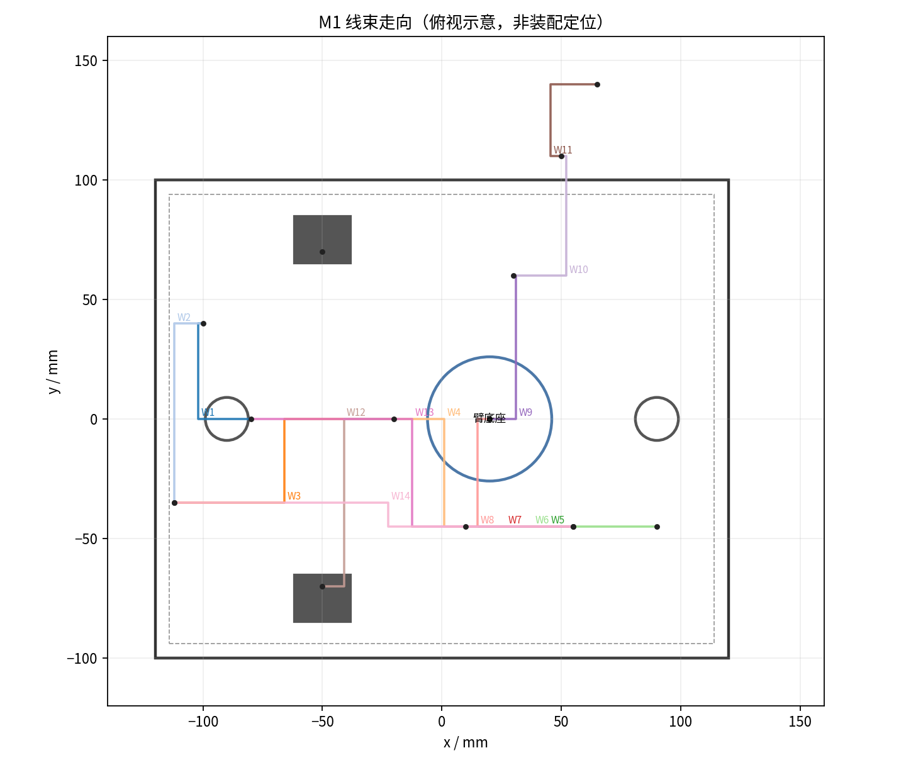

# 26 · 线束加工（自动生成）

> 数据源 `hardware/harness.json`；共 **14 根**，总长 **1960 mm**。
> 长度是**成品长度**（含两端余量），不是两点直线距离。

## 1. 裁线表

| 编号 | 从 | 到 | 长度 | 线号 | 连接器 | 备注 |
|---|---|---|---:|---|---|---|
| W1 | 电池 XT60 | 保险丝座 | 150 mm | 18AWG | XT60-M / 快插 | 正极，先过保险 |
| W2 | 保险丝座 | 急停按钮 | 120 mm | 18AWG | 快插 6.3mm | NC 回路 |
| W3 | 急停按钮 | 12V 分线端子 | 180 mm | 18AWG | 快插 6.3mm | 分给舵机与 DC-DC |
| W4 | 12V 分线端子 | DC-DC 5V 输入 | 100 mm | 20AWG | 焊接/端子 | 加 1A 保险更稳 |
| W5 | DC-DC 5V 输出 | ESP32 5V | 120 mm | 22AWG | USB-A / 排针 | 与树莓派共用 5V |
| W6 | DC-DC 5V 输出 | 树莓派 5V | 150 mm | 22AWG | USB-C / GPIO | 树莓派 4 需 3A |
| W7 | ESP32 TX/RX | 半双工收发器 | 80 mm | 24AWG | 杜邦 2.54 | TX/RX/GND 三根一组 |
| W8 | 收发器 DATA | 舵机 1 DATA | 200 mm | 24AWG | PH2.0-3P | 双绞更好 |
| W9 | 舵机 1 DATA | 舵机 2 DATA | 120 mm | 24AWG | PH2.0-3P | 菊花链 |
| W10 | 舵机 2 DATA | 舵机 3 DATA | 120 mm | 24AWG | PH2.0-3P | 沿臂走，留 20mm 弯折余量 |
| W11 | 舵机 3 DATA | 舵机 4 DATA | 100 mm | 24AWG | PH2.0-3P | 夹爪 |
| W12 | 12V 分线端子 | 驱动舵机 5/6 电源 | 220 mm | 18AWG | PH2.0-2P | 左右各一根，共 2 根 |
| W13 | 电池分压 | ESP32 GPIO5 | 140 mm | 26AWG | 杜邦 | 100k/20k，见 docs/03 §3.6 |
| W14 | 急停辅助触点 | ESP32 GPIO（可选） | 160 mm | 26AWG | 杜邦 | 用于记录急停状态 |

## 2. 备料汇总

| 线号 | 总长 | 建议多买 20% |
|---:|---:|---:|
| 18AWG | 670 mm | 804 mm |
| 20AWG | 100 mm | 120 mm |
| 22AWG | 270 mm | 324 mm |
| 24AWG | 620 mm | 744 mm |
| 26AWG | 300 mm | 360 mm |

## 3. 走线示意

> 示意只表达「谁连谁、大概走哪边」，不是装配定位图。实际以 [03-配电与线束](03-配电与线束.md) 为准。

## 4. 加工步骤

1. 按裁线表裁线（每根留 10mm 余量，压接后再修剪）；
2. 剥线 3mm，**不要伤到铜丝**（断股会让 12V 回路发热）；
3. 压接端子后拉一下（≥30N 不脱）；
4. 两端套热缩管 + 编号标签（`W8` 这种），标签朝同一方向；
5. 万用表通断档逐根测：两端导通、相邻两线不短路；
6. 上电前再测一次 12V 与 GND 是否短路（蜂鸣档不应响）。

## 5. 验收

- [ ] 14 根全部有编号，标签不脱落
- [ ] 每根通断正常，线间无短路
- [ ] 12V 回路（W1–W3、W12）用 18AWG，压接处不发热
- [ ] 舵机链（W8–W11）插头方向一致（DATA 对 DATA）
- [ ] 分压线（W13）接到 GPIO5，不是 5V

## 6. 还没做的

- 没有做线束长度实测（等实物装配后回填）
- 没有做弯折寿命测试（关节处反复弯折）
- 没有做 EMI 测试（1Mbps 半双工 + 电机噪声）
