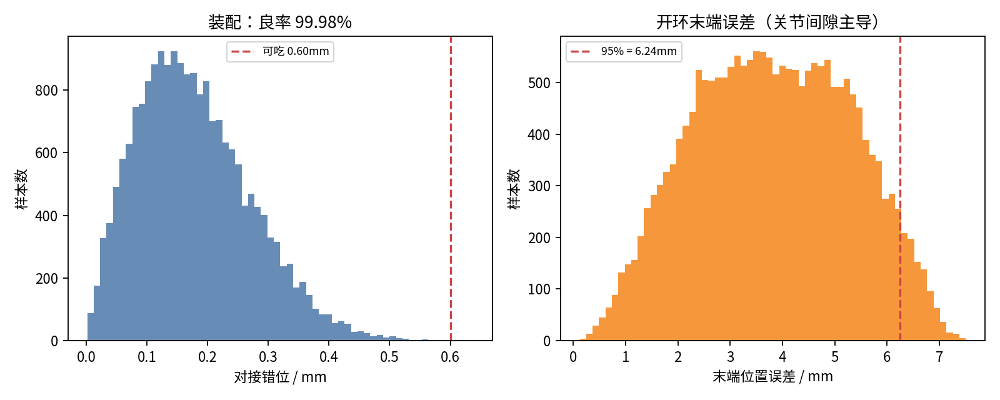

# 32 · 公差蒙特卡洛（自动生成）

> `cad/tolerance_mc.py`，20000 次采样、固定种子 20261025（可复现）。
> 假设：单件孔位 ±0.2mm（2σ）、对接孔 Ø3.6、关节径向间隙 0–0.2mm、舵盘半径 10.0mm。

## 1. 结论

- 对接装配良率 **99.98%**（错位 99 分位 0.43mm，可吃 0.6mm）
- 开环末端误差：中位 **3.81mm**、95 分位 **6.24mm**、99 分位 6.8mm
- **关节间隙是主导误差源**，不是打印孔位；想把末端做到 2mm 以内，必须闭环或预紧消隙

## 2. 装配（对接孔）

| 项 | 值 |
|---|---:|
| 采样数 | 20000 |
| 可吃错位 | 0.6 mm |
| 良率 | 99.98% |
| 中位错位 | 0.167 mm |
| 99 分位 | 0.43 mm |

## 3. 末端精度（开环）

| 关节（等效力臂） | 间隙 → 角度 |
|---|---|
| 230 mm | 0–0.2mm → 0–1.15° |
| 110 mm | 0–0.2mm → 0–1.15° |
| 40 mm | 0–0.2mm → 0–1.15° |

| 分位 | 误差 |
|---|---:|
| 50% | 3.81 mm |
| 95% | 6.24 mm |
| 99% | 6.8 mm |

## 4. 怎么改（按性价比）

1. **预紧/消隙**：关节加 0.1mm 垫片或偏心张紧，成本 ¥0，能把间隙压到 0.05mm；
2. **闭环**：编码器在舵机内部，末端闭环需要外部视觉/标定（M3）；
3. **缩短臂**：力臂 230→180mm，误差按比例降 22%；
4. **换舵机**：金属齿轮 + 更小回差（¥95→¥180/只），最后才考虑。

## 5. 局限

- 间隙按均匀分布，实际可能偏一侧（磨损后变大）；
- 没算舵机自身回差（实测 0.5–1°），真机会比这里更差；
- 力臂按单轴叠加，没做完整 DH 变换（保守估计）。
