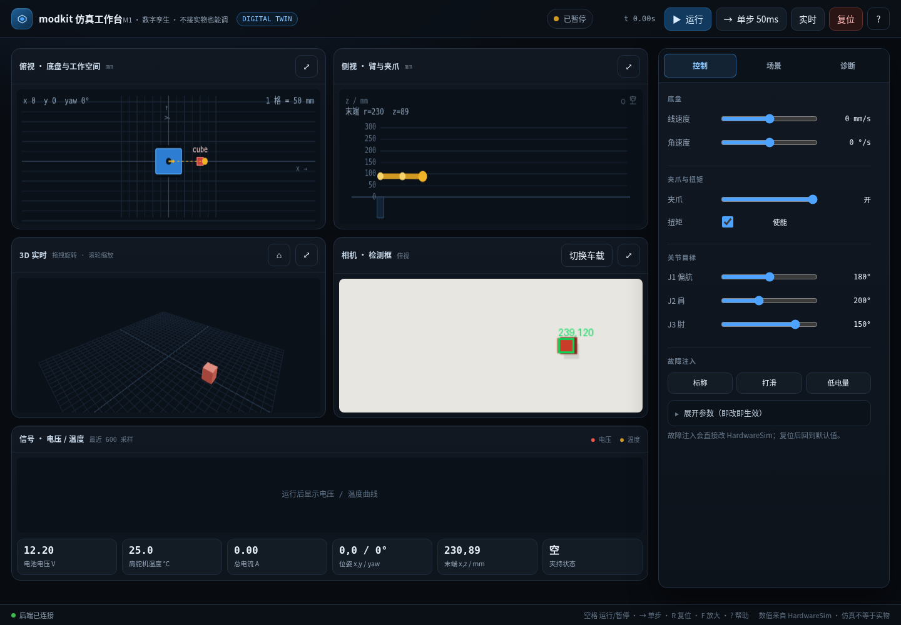
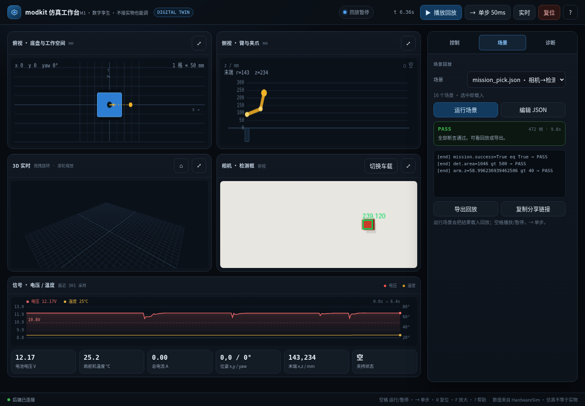

# 46 · 仿真工作台

> 不用装前端、不用连接硬件：`modkit simui` 起一个本地页面，拖滑杆就能驱动数字孪生。

## 1. 启动

```bash
modkit simui --port 8765 --open
```

打开 <http://127.0.0.1:8765/>。默认只监听 `127.0.0.1`，不对外网开放。



## 2. 界面

| 区域 | 内容 |
|---|---|
| 俯视图 | 底盘位姿、轮子、臂基座、末端投影、方块、历史轨迹（1 格 50mm） |
| 侧视图 | 肩/肘连杆、末端高度、夹持状态 |
| 3D | 底盘/两段臂/夹爪/方块，20ms 跟随；OrbitControls 旋转/缩放，可聚焦；见 [56](56-工作台3D实时视图.md) |
| 相机 | 当前视角的 320×240 检测图（绿框 + 像素坐标），可切车载/俯视 |
| 编辑器 | 场景 JSON 直接改、Ctrl+Enter 运行、保存到 sim/scenarios；见 [57](57-场景编辑器与回归基线.md) |
| 信号 | 电池电压、肩舵机温度（最近 600 帧） |
| 状态卡 | 电压/温度/电流/位姿/末端/夹持 |
| 控制 | 线速度、角速度、夹爪、扭矩、J1–J3 目标 |
| 故障注入 | 打滑、电池 OCV、负载、丢帧率、摩擦 μ、总线延迟、相机噪声 |

右栏是三个标签页：**控制 / 场景 / 诊断**，选择会记住。每个视图右上角 `⤢` 可聚焦，
或按 `F` 聚焦当前悬停面板，`Esc` 退出。

快捷键：`空格` 运行/暂停（回放时暂停回放），`→` 单步 50ms，`R` 复位，
`L` 回到实时，`F` 聚焦面板，`?` 帮助，`Esc` 退出聚焦/对话框。
"实时"按钮从回放退回实时仿真；"导出 JSON"把回放轨迹与日志存下来。

小屏（≤760px）用视图切换条在俯视/侧视/3D/相机之间切换，不再把四块画布竖着堆。
控制滑杆合并 45ms 内的请求；故障预设提供标称/打滑/低电量三键。

### 场景回放

右上"场景回放"选一个 `sim/scenarios/*.json`，点"运行场景"：后端跑完整场景，
返回轨迹与断言结果，前端按 20ms/帧回放，可暂停/单步/拖到任意帧。



深链直接打开某一帧：

```
http://127.0.0.1:8765/?scenario=mission_pick.json&frame=300
```

`play=1` 自动播放。

## 3. 后端

`simserver.py` 持有 `HardwareSim` + `Robot`，HTTP API：

| 方法 | 路径 | 作用 |
|---|---|---|
| GET | `/api/state` | 完整状态 + 最近 600 帧历史 |
| POST | `/api/step` | `{dt}` 步进（0.001–0.2s） |
| POST | `/api/control` | `{v,w,joints,gripper,torque,options}`，可只传一部分 |
| POST | `/api/reset` | 重建仿真，可带 `SimOptions` |

状态里带 `arm_side`（侧视连杆点）和 `ee`（世界末端），前端不做运动学。
夹持过摩擦锥：闭合 + 末端距方块 <35mm + `2μN ≥ m√(g²+a²)·1.5` 才吸附；
不够时状态卡显示"滑落"。参数和边界见 docs/47。

## 4. 为什么不是实时线程

浏览器每 50ms 发一次 `/api/step`，后端按请求步进，暂停时完全不推进。
好处是**确定性**：同样的操作顺序得到同样的轨迹，方便复现和自动化测试；
坏处是不接实时硬件时钟——真机联调仍走 `--sim`/串口。

## 5. 测试

16 项 HTTP 测试：首页、状态、步进+控制、复位、打滑、夹持、场景列表/运行/穿越防护、
查询串、相机 PNG/切换视角、故障参数即时生效、vendor 脚本、产品 UI 结构。
`tests/test_simserver.py`。

## 6. 还没做的

- 轨迹导出 GIF/视频（当前只有回放、JSON 导出与 `simplot` 出图）；
- 接触变形/滑动过程（当前只判掉不掉，见 docs/47）；
- 多机/多任务并发；
- 场景时间轴拖动（当前按按钮/深链帧跳转）。

## 7. v1.3 产品级 UI

v1.3 把工作台重做为深色产品界面：运行状态机、三标签右栏、面板聚焦、故障预设、
双轴曲线、场景结果卡、`<dialog>` 编辑器、帮助、toast、断线横幅、移动视图切换。
设计与验收见 [61-v1.3 UI 优化](61-v1.3-UI优化.md)。
